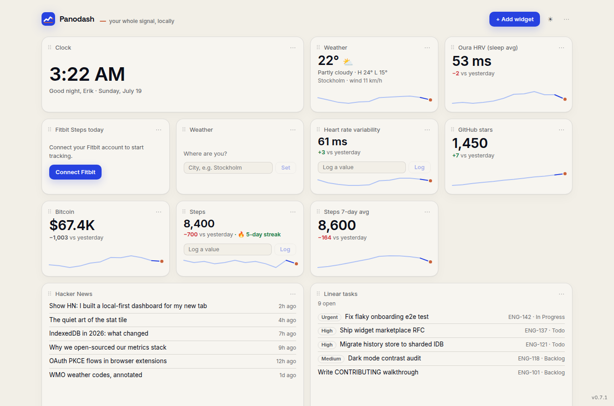

<p align="center">
  <picture>
    <source media="(prefers-color-scheme: dark)" srcset="brand/assets/panodash-lockup-dark.svg">
    
  </picture>
</p>

<p align="center"><strong>Every metric you care about. One private new tab.</strong></p>

Panodash replaces the browser's most disposable surface with a field of view
you own: health, work, audience, prices, weather, and feeds in one place,
with local history behind every number. Connect an API, type a value, or
import a CSV — Panodash keeps the record, draws the trend, and tracks your
goals and streaks. **No account. No telemetry. No data middleman.** Your
data doesn't need a landlord.



## What it does

- **One field of view** — GitHub and GitLab stars, notifications/to-dos, reviews, PR/MR momentum, cycle time, milestones, branch health, CI failures, issue triage, releases, and first-time contributors
  alongside REST APIs, Oura, Fitbit, Withings, WHOOP, Linear, RSS, weather,
  computed metrics, and anything you can type or import.
- **A memory, not a snapshot** — local time series with sparklines, charts,
  deltas, goal lines, streaks, and CSV in/out.
- **Private by architecture** — everything stays in local extension storage
  and IndexedDB; network requests go only to APIs you configure, behind
  per-origin permissions. Every credential Panodash holds is listed — and
  revocable — from one menu.
- **Yours to extend** — widgets are single-file providers, dashboards share
  as secret-stripped snippets, and the palette itself is yours to edit.

## Repository layout

```text
apps/
  extension/      Chrome Manifest V3 extension
  bridge/         Optional self-hostable OAuth bridge
packages/
  bridge-core/    Reusable OAuth bridge protocol and provider adapters
  core/           Snapshots, history, storage, calculations, OAuth clients
  widget-sdk/     Public provider contract and registry
  providers/      Built-in integrations and widget tiles
  ui/             Shared dashboard components
docs/             Architecture, protocol, privacy, editions, hosting, publishing
store/            Chrome Web Store copy, disclosures, screenshots
```

The package dependency direction is deliberate:

```text
widget-sdk <- core <- ui <- providers <- extension
```

Some packages use more than one package to their left, but shared packages
never import the extension. The bridge is independently deployable.

## Develop

Requires Node.js 22 or newer and npm.

```bash
npm ci
npm run dev
```

Load the unpacked extension from `apps/extension/dist` after running a
production build:

```bash
npm run build
```

Quality checks:

```bash
npm run typecheck
npm test
npm run build
```

Run the optional OAuth bridge with `npm run bridge`. Provider credentials
are described in [apps/bridge/README.md](apps/bridge/README.md).
GitLab token setup, self-managed instance support, and API differences are
documented in [docs/gitlab.md](docs/gitlab.md).

The bridge remains fully self-hostable. Paid operators can use the public,
provider-neutral activation response without changing the extension; see
[docs/bridge-protocol.md](docs/bridge-protocol.md) and
[docs/hosted-bridge.md](docs/hosted-bridge.md).

## Add a provider

If it has a number, it has a place. Implement the `WidgetProvider` contract
from `@panodash/widget-sdk`, place the built-in integration under
`packages/providers/src`, then register it in
`packages/providers/src/index.ts`. Parsing, storage, and calculations belong
in `@panodash/core`; reusable presentation belongs in `@panodash/ui`.

See [CONTRIBUTING.md](CONTRIBUTING.md) for the contribution workflow and
[docs/architecture.md](docs/architecture.md) for system boundaries.

## Privacy and security

Your metrics. Your machine. Panodash stores dashboard configuration,
snapshots, and history locally in the browser and makes provider requests
only for widgets you configure. The optional bridge stores OAuth refresh
tokens but never proxies metric payloads — and anyone can run their own.
Read [docs/privacy.md](docs/privacy.md) and report vulnerabilities
according to [SECURITY.md](SECURITY.md).

## License

Panodash is available under the [MIT License](LICENSE). The license covers
code, not permission to imply endorsement or use Panodash trademarks; see
[TRADEMARK.md](TRADEMARK.md).
